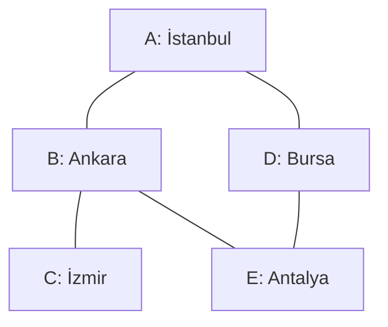
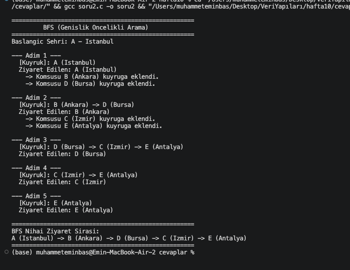
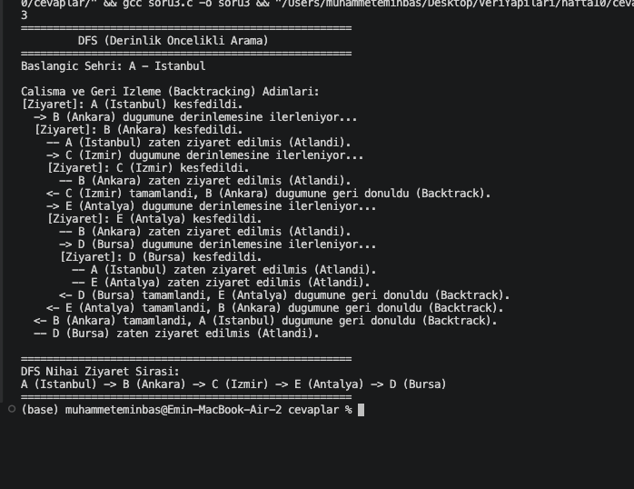

# Hafta 10: Graf Yapıları, BFS ve DFS Algoritmaları

Bu klasör, Veri Yapıları Laboratuvarı **Hafta 10: Graf Yapıları, BFS (Breadth-First Search) ve DFS (Depth-First Search)** çalışmasına ait teorik analizleri, graf çizimlerini, adım adım algoritma izleme tablolarını, C dili kaynak kodlarını ve program çalışma çıktılarını içermektedir.

---

## İçerik ve Klasör Yapısı

```text
hafta10/
├── 10.haftaOdev.pdf                  # Laboratuvar föyü ve ödev soru metni
├── README.md                         # Hafta 10 kapsamlı dokümantasyonu ve çözümleri
├── cevaplar/
│   ├── graf.png                      # 1. Soru: 5 şehirli graf yapısının görsel çizimi
│   ├── soru2.c                       # 2. Soru: FIFO Kuyruk ile BFS C kaynak kodu
│   └── soru3.c                       # 3. Soru: Özyinelemeli (Recursive) DFS C kaynak kodu
└── ekran_goruntuleri/
    ├── soru2_cikti.png               # 2. Soru: BFS algoritması terminal ekran çıktısı
    └── soru3_cikti.png               # 3. Soru: DFS algoritması terminal ekran çıktısı
```

---

## Problemin Tanımı ve Graf Verileri

Verilen 5 şehirden oluşan yönsüz (undirected) graf yapısı:

| Düğüm Kodu | Şehir Adı | Komşuları                            | Düğüm Derecesi (Degree) |
| :--------: | :-------- | :----------------------------------- | :---------------------: |
|   **A**    | İstanbul  | B (Ankara), D (Bursa)                |            2            |
|   **B**    | Ankara    | A (İstanbul), C (İzmir), E (Antalya) |            3            |
|   **C**    | İzmir     | B (Ankara)                           |     1 (Uç/Pendant)      |
|   **D**    | Bursa     | A (İstanbul), E (Antalya)            |            2            |
|   **E**    | Antalya   | B (Ankara), D (Bursa)                |            2            |

- **Düğüm Sayısı ($|V|$):** 5
- **Kenar Sayısı ($|E|$):** 5
- **Toplam Derece:** $2 + 3 + 1 + 2 + 2 = 10 = 2 \times |E|$ (El Sıkışma Teoremi doğrulanmıştır)

---

## 1. Soru – Graf Yapısının Çizimi ve Gösterimleri

### A) Graf Şeması

```text
          [ A: İstanbul ]
           /           \
          /             \
    [ D: Bursa ]     [ B: Ankara ] ---- [ C: İzmir ]
          \             /
           \           /
          [ E: Antalya ]
```




### B) Komşuluk Matrisi (Adjacency Matrix)

Grafiksel bağlantıların $5 \times 5$'lik matris gösterimi:

$$
M = \begin{pmatrix}
0 & 1 & 0 & 1 & 0 \\
1 & 0 & 1 & 0 & 1 \\
0 & 1 & 0 & 0 & 0 \\
1 & 0 & 0 & 0 & 1 \\
0 & 1 & 0 & 1 & 0
\end{pmatrix}
$$

- **Satır A (İstanbul):** B ve D sütunları 1
- **Satır B (Ankara):** A, C ve E sütunları 1
- **Satır C (İzmir):** B sütunu 1
- **Satır D (Bursa):** A ve E sütunları 1
- **Satır E (Antalya):** B ve D sütunları 1

### C) Komşuluk Listesi (Adjacency List)

- **A (İstanbul):** $\rightarrow$ B $\rightarrow$ D $\rightarrow$ NULL
- **B (Ankara):** $\rightarrow$ A $\rightarrow$ C $\rightarrow$ E $\rightarrow$ NULL
- **C (İzmir):** $\rightarrow$ B $\rightarrow$ NULL
- **D (Bursa):** $\rightarrow$ A $\rightarrow$ E $\rightarrow$ NULL
- **E (Antalya):** $\rightarrow$ B $\rightarrow$ D $\rightarrow$ NULL

---

## 2. Soru – BFS (Genişlik Öncelikli Arama) Algoritması ve Kodu

- **Dosya:** `cevaplar/soru2.c`
- **Mantık:** Başlangıç düğümünden itibaren komşular seviye seviye (katman katman) ziyaret edilir. Önce 1 kenar uzaklıktaki tüm şehirler, ardından 2 kenar uzaklıktakiler işlenir.
- **Kullanılan Veri Yapısı:** FIFO (First In First Out) **Kuyruk (Queue)**.
- **Başlangıç Şehri:** **A (İstanbul)** (Komşu ziyaretlerinde alfabetik/indis sırası uygulanmıştır).

### Adım Adım Kuyruk Simülasyonu:

| Adım  | İşlem / Olay                                           | Kuyruk Durumu (Queue) | Ziyaret Edilenler Sırası                                              |
| :---: | :----------------------------------------------------- | :-------------------- | :-------------------------------------------------------------------- |
| **0** | Başlangıç: A kuyruğa eklenir                           | `[ A ]`               | -                                                                     |
| **1** | A çıkarılır. Komşuları (B, D) kuyruğa eklenir          | `[ B, D ]`            | **A**                                                                 |
| **2** | B çıkarılır. Komşuları (C, E) kuyruğa eklenir          | `[ D, C, E ]`         | **A $\rightarrow$ B**                                                 |
| **3** | D çıkarılır. Ziyaretsiz komşusu yok (E zaten kuyrukta) | `[ C, E ]`            | **A $\rightarrow$ B $\rightarrow$ D**                                 |
| **4** | C çıkarılır. Komşusu B zaten ziyaretli                 | `[ E ]`               | **A $\rightarrow$ B $\rightarrow$ D $\rightarrow$ C**                 |
| **5** | E çıkarılır. Komşuları (B, D) zaten ziyaretli          | `[ ]` (Boş)           | **A $\rightarrow$ B $\rightarrow$ D $\rightarrow$ C $\rightarrow$ E** |

**BFS Nihai Ziyaret Sırası:**  
$$\mathbf{A\text{ (İstanbul)} \rightarrow B\text{ (Ankara)} \rightarrow D\text{ (Bursa)} \rightarrow C\text{ (İzmir)} \rightarrow E\text{ (Antalya)}}$$

### Derleme ve Çalıştırma:

```bash
cd hafta10/cevaplar
gcc soru2.c -o soru2
./soru2
```

### Ekran Görüntüsü:



---

## 3. Soru – DFS (Derinlik Öncelikli Arama) Algoritması ve Kodu

- **Dosya:** `cevaplar/soru3.c`
- **Mantık:** Bir dal boyunca gidilebilecek en derin noktaya kadar ilerlenir. Çıkmaz sokağa (dead end) gelindiğinde geri dönülerek (**Backtracking**) keşfedilmemiş diğer dallar taranır.
- **Kullanılan Veri Yapısı:** LIFO (Last In First Out) **Yığın (Stack)** veya programlama dili **Çağrı Yığını (Recursion)**.
- **Başlangıç Şehri:** **A (İstanbul)** (Komşu ziyaretlerinde alfabetik öncelik gözetilmiştir).

### Adım Adım DFS ve Geri İzleme (Backtracking) Tablosu:

| Adım  | Aktif Düğüm                           | Gerçekleşen İşlem                        | Geri İzleme (Backtracking) | Ziyaret Sırası                                                        |
| :---: | :------------------------------------ | :--------------------------------------- | :------------------------- | :-------------------------------------------------------------------- |
| **1** | **A (İstanbul)**                      | A keşfedildi. İlk komşu B'ye ilerlendi.  | -                          | **A**                                                                 |
| **2** | **B (Ankara)**                        | B keşfedildi. İlk komşu C'ye ilerlendi.  | -                          | **A $\rightarrow$ B**                                                 |
| **3** | **C (İzmir)**                         | C keşfedildi. Gidecek komşu kalmadı.     | **B'ye geri dönüldü**      | **A $\rightarrow$ B $\rightarrow$ C**                                 |
| **4** | **B (Ankara)**                        | B'nin diğer komşusu E'ye ilerlendi.      | -                          | **A $\rightarrow$ B $\rightarrow$ C**                                 |
| **5** | **E (Antalya)**                       | E keşfedildi. Komşusu D'ye ilerlendi.    | -                          | **A $\rightarrow$ B $\rightarrow$ C $\rightarrow$ E**                 |
| **6** | **D (Bursa)**                         | D keşfedildi. Komşular (A, E) ziyaretli. | **E'ye geri dönüldü**      | **A $\rightarrow$ B $\rightarrow$ C $\rightarrow$ E $\rightarrow$ D** |
| **7** | **E $\rightarrow$ B $\rightarrow$ A** | Tüm düğümler taranıp başlangıca dönüldü. | Çağrı yığını tamamlandı    | **A $\rightarrow$ B $\rightarrow$ C $\rightarrow$ E $\rightarrow$ D** |

**DFS Nihai Ziyaret Sırası:**  
$$\mathbf{A\text{ (İstanbul)} \rightarrow B\text{ (Ankara)} \rightarrow C\text{ (İzmir)} \rightarrow E\text{ (Antalya)} \rightarrow D\text{ (Bursa)}}$$

### Derleme ve Çalıştırma:

```bash
cd hafta10/cevaplar
gcc soru3.c -o soru3
./soru3
```

### Ekran Görüntüsü:



---

## BFS ve DFS Algoritmalarının Karşılaştırılması

| Karşılaştırma Kriteri       | Soru 2: BFS (Genişlik Öncelikli Arama)                                 | Soru 3: DFS (Derinlik Öncelikli Arama)                                   |
| :-------------------------- | :--------------------------------------------------------------------- | :----------------------------------------------------------------------- |
| **C Kaynak Dosyası**        | `cevaplar/soru2.c`                                                     | `cevaplar/soru3.c`                                                       |
| **Kullanılan Veri Yapısı**  | Kuyruk (Queue - FIFO)                                                  | Yığın (Stack - LIFO) / Özyineleme                                        |
| **Zaman Karmaşıklığı**      | $\mathcal{O}(\|V\| + \|E\|) = 5 + 5 = 10$ işlem                        | $\mathcal{O}(\|V\| + \|E\|) = 5 + 5 = 10$ işlem                          |
| **Alan Karmaşıklığı**       | $\mathcal{O}(\|V\|)$ (Kuyruk kapasitesi)                               | $\mathcal{O}(\|V\|)$ (Çağrı yığını derinliği)                            |
| **En Kısa Yol Garantisi**   | Ağırlıksız graflarda en az kenarlı en kısa yolu garanti eder           | En kısa yol garantisi vermez                                             |
| **Ziyaret Karakteri**       | Merkezden dışa doğru dalga dalga yayılır                               | Seçilen dal boyunca sonuna kadar dalar                                   |
| **Tipik Kullanım Alanları** | En kısa yol bulma, GPS harita yönlendirme, web tarayıcıları (crawlers) | Döngü (cycle) tespiti, labirent çözme, topolojik sıralama, oyun ağaçları |
| **Bu Graf İçin Sonuç**      | `A -> B -> D -> C -> E`                                                | `A -> B -> C -> E -> D`                                                  |


