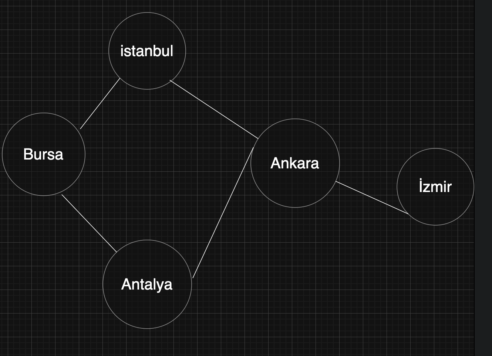

# Hafta 10: Graf Yapıları, BFS ve DFS Algoritmaları

Bu klasör, Veri Yapıları Laboratuvarı **Hafta 10: Graf Yapıları, BFS (Breadth-First Search) ve DFS (Depth-First Search)** çalışmasına ait teorik analizleri, graf çizimlerini, adım adım algoritma izleme tablolarını, C dili kaynak kodlarını ve program çalışma çıktılarını içermektedir.

---

## İçerik ve Klasör Yapısı

```text
hafta10/
├── 10.haftaOdev.pdf                  # Laboratuvar föyü ve ödev soru metni
├── README.md                         # Hafta 10 kapsamlı dokümantasyonu ve çözümleri
├── cevaplar/
│   ├── graf.png                      # 1. Soru: 5 şehirli graf yapısının görsel çizimi
│   ├── soru2.c                       # 2. Soru: FIFO Kuyruk ile BFS C kaynak kodu
│   └── soru3.c                       # 3. Soru: Özyinelemeli (Recursive) DFS C kaynak kodu
└── ekran_goruntuleri/
    ├── soru2_cikti.png               # 2. Soru: BFS algoritması terminal ekran çıktısı
    └── soru3_cikti.png               # 3. Soru: DFS algoritması terminal ekran çıktısı
```


## 1. Soru – Graf Yapısının Çizimi ve Gösterimleri





## 2. Soru – BFS (Genişlik Öncelikli Arama) Algoritması 


### Çıktı Ekran Görüntüsü:


---

## 3. Soru – DFS (Derinlik Öncelikli Arama) Algoritması


### Çıktı Ekran Görüntüsü:


---

## BFS ve DFS Algoritmalarının Karşılaştırılması

| Karşılaştırma Kriteri       | Soru 2: BFS (Genişlik Öncelikli Arama)                                 | Soru 3: DFS (Derinlik Öncelikli Arama)                                   |
| :-------------------------- | :--------------------------------------------------------------------- | :----------------------------------------------------------------------- |
| **C Kaynak Dosyası**        | `cevaplar/soru2.c`                                                     | `cevaplar/soru3.c`                                                       |
| **Kullanılan Veri Yapısı**  | Kuyruk (Queue - FIFO)                                                  | Yığın (Stack - LIFO) / Özyineleme                                        |
| **Zaman Karmaşıklığı**      | 5 + 5 =10 işlem 0(n)                                                   | 5 + 5 = 10 işlem  O(n)                                                   |
| **Alan Karmaşıklığı**       |  (Kuyruk kapasitesi)                                                   | Çağrı yığını derinliği                                                   |
| **En Kısa Yol Garantisi**   | Ağırlıksız graflarda en az kenarlı en kısa yolu garanti eder           | En kısa yol garantisi vermez                                             |
| **Ziyaret Karakteri**       | Merkezden dışa doğru dalga dalga yayılır                               | Seçilen dal boyunca sonuna kadar dalar                                   |
| **Tipik Kullanım Alanları** | En kısa yol bulma, GPS harita yönlendirme, web tarayıcıları (crawlers) | Döngü (cycle) tespiti, labirent çözme, topolojik sıralama, oyun ağaçları |
| **Bu Graf İçin Sonuç**      | `A -> B -> D -> C -> E`                                                | `A -> B -> C -> E -> D`                                                  |


