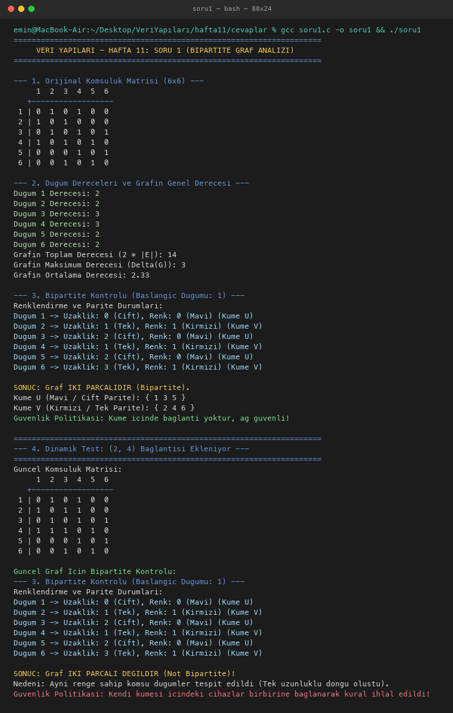
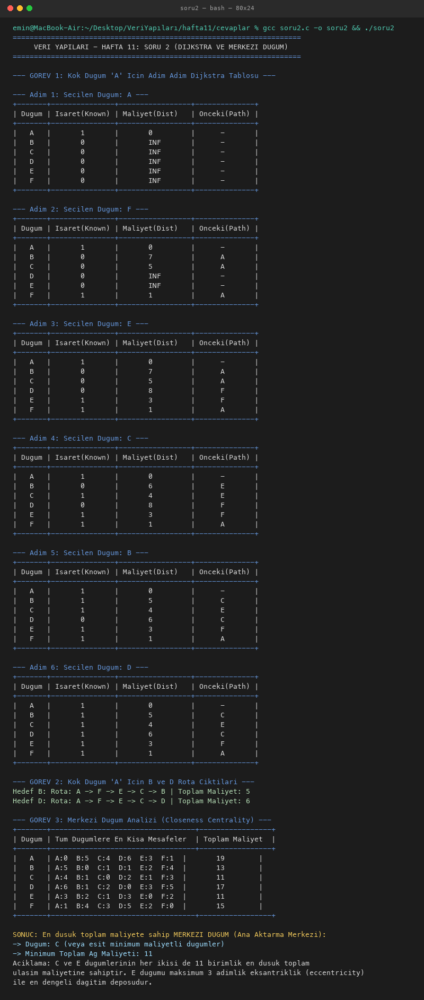
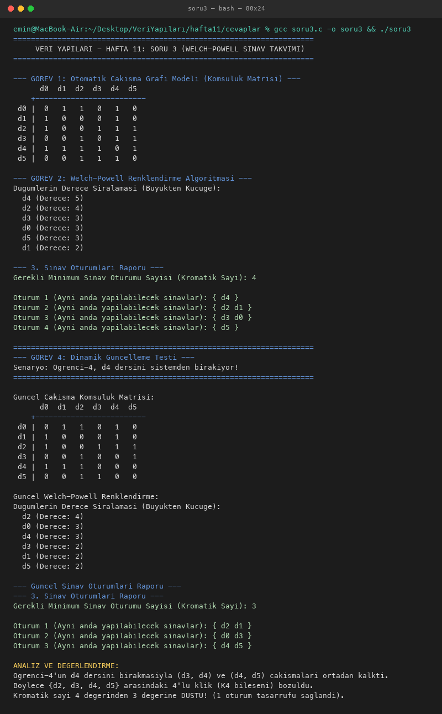

# Hafta 11: İki Parçalı Graflar (Bipartite), En Kısa Yol (Dijkstra) ve Graf Renklendirme (Welch-Powell)

Bu klasör, Veri Yapıları Laboratuvarı **Hafta 11: İki Parçalı Graf Analizi (Bipartite Graph), En Az Maliyetli Yol ve Merkezi Düğüm Analizi (Dijkstra) ile Çakışmasız Sınav Takvimi Oluşturma (Welch-Powell Algoritması)** çalışmasına ait teorik çözümleri, C dili kaynak kodlarını ve program çalışma çıktılarını içermektedir.

---

## İçerik ve Klasör Yapısı

```text
hafta11/
├── hafta11_sorular.pdf               
├── README.md                        
├── cevaplar/
│   ├── soru1.c                       # Soru 1: Komşuluk matrisi, derece hesabı, Bipartite testi ve dinamik test
│   ├── soru2.c                       # Soru 2: Dijkstra tablosu, rota bulma (backtrack) ve merkezi düğüm analizi
│   └── soru3.c                       # Soru 3: Çakışma grafı, Welch-Powell renklendirme ve dinamik güncelleme
└── ekran_goruntuleri/
    ├── soru1_cikti.png               # Soru 1 konsol çalışma ekran çıktısı
    ├── soru2_cikti.png               # Soru 2 konsol çalışma ekran çıktısı
    └── soru3_cikti.png               # Soru 3 konsol çalışma ekran çıktısı
```

---

## Soru 1: Ağ Güvenliği ve İki Parçalı Graf (Bipartite) Analizi


#### Derleme ve Çalıştırma:
```bash
cd hafta11/cevaplar
gcc soru1.c -o soru1 && ./soru1
```

#### Ekran Görüntüsü:


---

## Soru 2: En Az Maliyetli Yol ve Merkezi Düğüm Analizi (Dijkstra)

#### Derleme ve Çalıştırma:
```bash
cd hafta11/cevaplar
gcc soru2.c -o soru2 && ./soru2
```

#### Ekran Görüntüsü:


---

## Soru 3: Çakışmasız Sınav Takvimi (Welch-Powell Algoritması)


#### Derleme ve Çalıştırma:
```bash
cd hafta11/cevaplar
gcc soru3.c -o soru3 && ./soru3
```

#### Ekran Görüntüsü:

