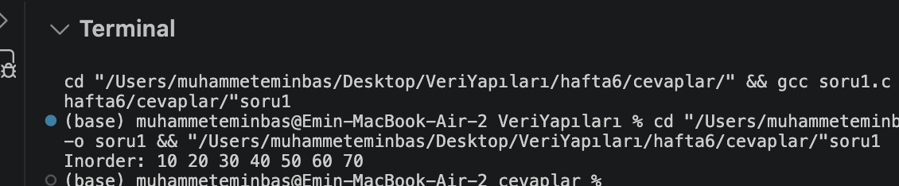
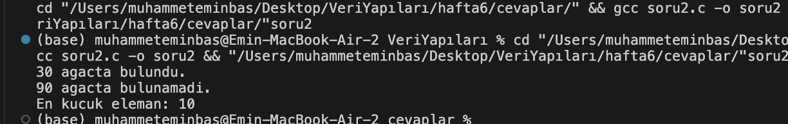

# Hafta 6: Ikili Arama Agaci (Binary Search Tree - BST)

Bu calismada, C programlama dili ile Ikili Arama Agaci (BST) veri yapisi uzerinde dugum olusturma, eleman ekleme, agaci kucukten buyuge siralama (inorder traversal), eleman arama (search) ve en kucuk elemani bulma (findMin) islemleri gerceklestirilmistir.

## Kullanilan Veri Yapilari ve Algoritmalar

1. **Dugum Yapisi (Node):**
   * Her dugum bir tam sayi degeri (`data`) ile sol (`left`) ve sag (`right`) cocuk isaretcilerini icerir.

2. **BST Eleman Ekleme (`insert`):**
   * BST kuralina gore kokten kucuk degerler sol alt agaca, buyuk degerler sag alt agaca yerlestirilir.
   * Mukerrer (ayni) degerler icin agacta yeni dugum olusturulmaz.

3. **Inorder Dolasma (`inorder`):**
   * `Sol Alt Agac -> Kok -> Sag Alt Agac` sirasi takip edilerek agactaki elemanlar kucukten buyuge sirali sekilde yazdirilir.

4. **Arama (`search`):**
   * Aranan deger her adimda karsilastirilarak yalnizca ilgili dala (saga veya sola) dallanilarak aranir. Bulunursa 1, bulunamazsa 0 degeri doner.

5. **En Kucuk Elemani Bulma (`findMin`):**
   * BST ozelligi geregi en kucuk deger her zaman en soldaki dugumde yer alir. Surekli sol isaretci takip edilerek minimum degere ulasilir.

---

## Dosya Yapisi

* `6.HaftaSorular.pdf`: 6. hafta laboratuvar ve odev sorulari belgesi.
* `cevaplar/soru1.c`: BST olusturma, `insert()` ve `inorder()` fonksiyonlarini iceren C kaynak kodu.
* `cevaplar/soru2.c`: Agac uzerinde arama (`search`) ve minimum degeri bulma (`findMin`) islemlerini iceren C kaynak kodu.
* `cevaplar/degerlendirme_sorulari.txt`: Agaca 25 elemani ekleme, Preorder siralamasi ve sag dal takibinin (findMax) aciklandigi teorik sorular ve cozumleri.
* `cevaplar/ciktilar/`: Kodlarin basariyla calistigini gosteren terminal ekran goruntuleri (`soru1_cikti.png`, `soru2_cikti.png`).

---

## Nasil Calistirilir?

Terminalde `hafta6/cevaplar` klasorune gidip ilgili kaynak kodlari `gcc` ile derleyip calistirabilirsiniz:

### Soru 1 Derleme ve Calistirma
```bash
cd hafta6/cevaplar
gcc soru1.c -o soru1
./soru1
```

**Beklenen Cikti:**
```text
Inorder: 10 20 30 40 50 60 70
```

### Soru 2 Derleme ve Calistirma
```bash
gcc soru2.c -o soru2
./soru2
```

**Beklenen Cikti:**
```text
30 agacta bulundu.
90 agacta bulunamadi.
En kucuk eleman: 10
```

---

## Ekran Goruntuleri

### Soru 1 Ciktisi


### Soru 2 Ciktisi

