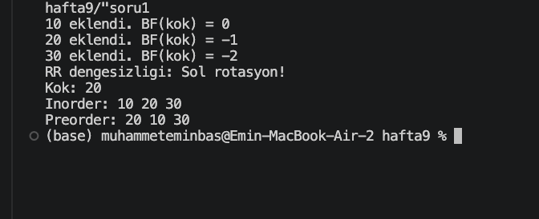
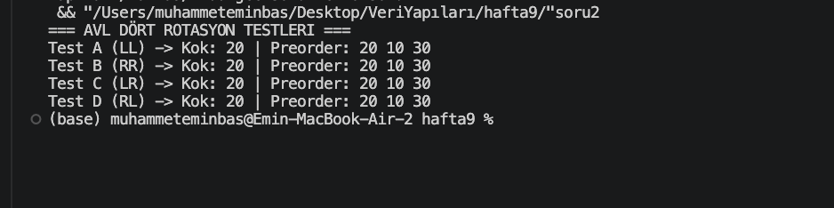

# Hafta 9: Dengeli Arama Ağaçları (AVL Tree)

Bu klasör, Veri Yapıları Laboratuvarı **Hafta 9: Dengeli Arama Ağaçları (AVL Tree)** çalışmasına ait teorik çözümleri, C dili kaynak kodlarını ve program çıktılarını içermektedir.

---

## 📌 İçerik ve Klasör Yapısı

```text
hafta9/
├── hafta9Sorular.pdf           # Laboratuvar föyü ve soru metinleri
├── soru1.c                     # Soru 1: Tek rotasyonlu (RR) AVL ekleme kodu
├── soru2.c                     # Soru 2: Dört rotasyonu (LL, RR, LR, RL) destekleyen genel AVL kodu
├── README.md                   # Hafta 9 dokümantasyonu ve açıklamalar
├── cevaplar/
│   ├── Veri_Yapilari_AVL_Odevi.pdf  # Çizimler, adım adım hesaplamalar ve pekiştirme sorularının çözümleri
│   ├── soru1.c
│   └── soru2.c
└── ekran_goruntuleri/
    ├── soru1_cikti.png         # Soru 1 konsol çalışma çıktısı
    └── soru2_cikti.png         # Soru 2 konsol çalışma çıktısı
```

---

## 📝 Sorular ve Uygulama Detayları

### 🔹 Soru 1 – AVL Ağacına Ekleme ve Tek Rotasyon
* **Amaç:** Boş bir BST ağacına sırasıyla `10, 20, 30` sayılarını ekleyerek denge faktörünü ($BF = \text{Sol} - \text{Sağ}$) hesaplamak ve sınır aşıldığında ($BF = -2$) oluşan **RR (Right-Right)** dengesizliğini **Sola Tek Rotasyon (rotateLeft)** ile gidermek.
* **Fonksiyonlar:** `createNode`, `insertBST`, `height`, `balanceFactor`, `rotateLeft`, `inorder`, `preorder`.

#### Derleme ve Çalıştırma:
```bash
gcc soru1.c -o soru1
./soru1
```

#### Beklenen Çıktı:
```text
10 eklendi. BF(kok) = 0
20 eklendi. BF(kok) = -1
30 eklendi. BF(kok) = -2
RR dengesizligi: Sol rotasyon!
Kok: 20
Inorder: 10 20 30 
Preorder: 20 10 30 
```

#### Ekran Görüntüsü:


---

### 🔹 Soru 2 – AVL Ağacında Dört Rotasyon Durumu
* **Amaç:** Dört temel dengesizlik durumunu (LL, RR, LR, RL) otomatik tespit edip düzelten genel bir `insertAVL` fonksiyonu geliştirmek ve verilen bağımsız diziler üzerinde test etmek:
  * **Test A (LL):** `30, 20, 10` $\rightarrow$ Sağa Tek Rotasyon (`rotateRight`)
  * **Test B (RR):** `10, 20, 30` $\rightarrow$ Sola Tek Rotasyon (`rotateLeft`)
  * **Test C (LR):** `30, 10, 20` $\rightarrow$ Sol-Sağ Çift Rotasyon (`rotateLeft` ardından `rotateRight`)
  * **Test D (RL):** `10, 30, 20` $\rightarrow$ Sağ-Sol Çift Rotasyon (`rotateRight` ardından `rotateLeft`)

#### Derleme ve Çalıştırma:
```bash
gcc soru2.c -o soru2
./soru2
```

#### Beklenen Çıktı:
```text
=== AVL DÖRT ROTASYON TESTLERI ===
Test A (LL) -> Kok: 20 | Preorder: 20 10 30 
Test B (RR) -> Kok: 20 | Preorder: 20 10 30 
Test C (LR) -> Kok: 20 | Preorder: 20 10 30 
Test D (RL) -> Kok: 20 | Preorder: 20 10 30 
```

#### Ekran Görüntüsü:


---

## 📚 Teorik ve Pekiştirme Soruları Özeti

* **Inorder Dolaşımı:** AVL ağaçlarında `inorder` dolaşımı (Sol - Kök - Sağ), ikili arama ağacı kuralı ($Sol < Kök < Sağ$) ve rotasyonların sıralamayı koruma garantisi sayesinde elemanları daima **küçükten büyüğe (artan sırada)** verir.
* **2-3 Tree (2-3 Ağaçları):** `10, 20, 30` sayıları eklendiğinde düğüm 3 anahtarla taşar (overflow). Düğüm bölünür (split) ve ortanca eleman olan **`20` köke yükselir**. Sol çocuk `[10]`, sağ çocuk `[30]` olur.
* **AVL vs. Red-Black Tree:** AVL ağaçları katı yükseklik dengesi ($|BF| \le 1$) uygulayarak daha sığ ağaçlar üretir ve **arama odaklı** sistemlerde daha hızlıdır. Red-Black Tree ise renk kurallarıyla daha esnek bir denge kurarak daha az rotasyon yapar ve **ekleme/silme odaklı** sistemlerde daha yüksek performans sunar.

Detaylı çizimler ve tablolar için `cevaplar/Veri_Yapilari_AVL_Odevi.pdf` dosyasını inceleyebilirsiniz.
